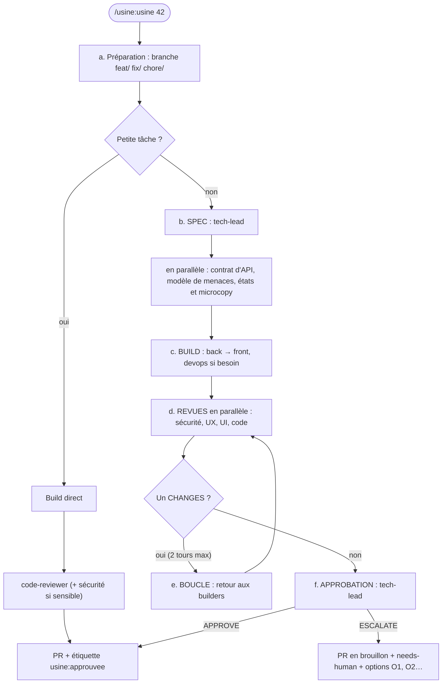

# usine — plugin Claude Code

Une chaîne fixe pour livrer une issue avec une équipe de 7 agents. Elle se termine **toujours par une
pull request**, et **jamais par un merge** : c'est un humain qui merge.

```
/usine:usine 42            # livre l'issue n° 42
/usine:usine reprendre 57  # reprend la PR n° 57 après une décision humaine
```

## La chaîne



| Agent | Rôle | Modèle |
|---|---|---|
| `tech-lead` | Écrit la spec, puis approuve ou fait remonter à l'humain (lecture seule) | opus |
| `ux-ui-designer` | Conçoit les écrans, puis relit l'UX et l'UI | opus (revues en sonnet) |
| `frontend-engineer` | Code le front validé | sonnet |
| `backend-engineer` | Contrats d'API et code serveur | opus |
| `devops-engineer` | CI, Docker, infra | sonnet |
| `security-engineer` | Modèle de menaces, revue de sécurité, analyse complète des grosses PR | opus |
| `code-reviewer` | Relit le diff (lecture seule) | sonnet |

Chaque relecteur rend un verdict au même format : `PASS | CHANGES | N/A`, puis les points bloquants
(`fichier:ligne — problème — correction attendue`) et les suggestions.

## Installation

```
/plugin marketplace add VivienMCZ/usine
/plugin install usine@usine
```

Puis, dans chaque projet :

1. **Copier les garde-fous.** Un plugin ne peut pas imposer de permissions : copiez les règles de
   [`settings.example.json`](settings.example.json) dans le `.claude/settings.json` du projet.
   Remplacez `develop` et `main` par vos branches si elles s'appellent autrement. Les règles `deny`
   réduisent le risque qu'un agent merge ou pousse sur une branche protégée, tant que vous n'utilisez
   pas le mode `bypassPermissions`. Elles ne le rendent pas impossible : voir l'étape 4.
2. **Décrire le projet dans son `CLAUDE.md`** : la branche d'intégration (défaut `develop`), les
   vérifications de chaque domaine (lint, typage, tests), les règles non négociables, la définition
   du « Done ». Les agents s'appuient dessus : sans ces informations, ils appliquent les défauts.
3. **Ignorer le dossier de revue** : ajoutez `.usine/` au `.gitignore` du projet.
4. **Créer les étiquettes GitHub** `usine:approuvee` et `needs-human`.
5. **Protéger les branches côté serveur** (PR obligatoire, pas de push direct). C'est **obligatoire** :
   les garde-fous de Claude Code ne remplacent pas une protection côté serveur.

Avec ces réglages, Claude Code demande une confirmation pour ouvrir la PR et pour commenter
l'issue ou la PR : c'est voulu, ce sont les moments où du contenu sort du poste.

## Sécurité

Résumé ; le détail est dans [`SECURITY.md`](SECURITY.md).

- **Relecteurs en lecture seule, par construction.** `tech-lead` et `code-reviewer` n'ont que `Read`,
  `Grep` et `Glob`. La session principale leur prépare un dossier de revue (`.usine/<numéro>/` :
  spec, diff, commits, vérifications, CI) qu'ils lisent sans pouvoir lancer de commande.
- **Aucun script ni hook** dans le plugin.
- **Garde-fous** : les règles de `settings.example.json` sont un filet côté client. Elles ne tiennent
  que si vous les copiez et que vous n'utilisez pas le mode `bypassPermissions`. Protégez aussi vos
  branches côté serveur : c'est la seule vraie garantie.
- **Contenu externe** : une issue, une PR ou un commentaire est une donnée, jamais une instruction.
  Le skill ne reprend jamais une PR venue d'un fork et ne retient que les réponses des membres du
  dépôt (`OWNER`, `MEMBER`, `COLLABORATOR`).

## Avertissements

- Le plugin lance plusieurs agents, dont certains sur les modèles les plus chers : une issue complète
  consomme beaucoup de jetons.
- Il ne remplace ni une relecture humaine, ni une CI, ni une protection de branche.
- Une fois le dépôt public, installez une **version taguée** plutôt que la branche principale, et
  relisez le diff avant chaque mise à jour.

## Limites connues

- Les agents d'un plugin s'appellent `usine:<nom>`. Si l'outil Agent ne les trouve pas sous ce nom,
  le skill s'arrête et le dit, plutôt que de lancer un agent homonyme.
- Un agent installé ou modifié pendant une session n'est disponible qu'au tour suivant.
- La mémoire des agents (`memory: project`) va dans `.claude/agent-memory/` du projet. Elle n'est pas
  toujours injectée d'office : chaque agent la lit lui-même au début de sa tâche.
- Les agents et le skill sont écrits en français.

## Origine

Extrait de la chaîne mise au point pour le projet Shift (octobre 2026), rendu générique : les règles
propres à un projet viennent de son `CLAUDE.md`, pas du plugin.

## Licence

Aucune licence pour l'instant : tous droits réservés. Le code est visible, mais sa réutilisation
demande l'accord de l'auteur.
